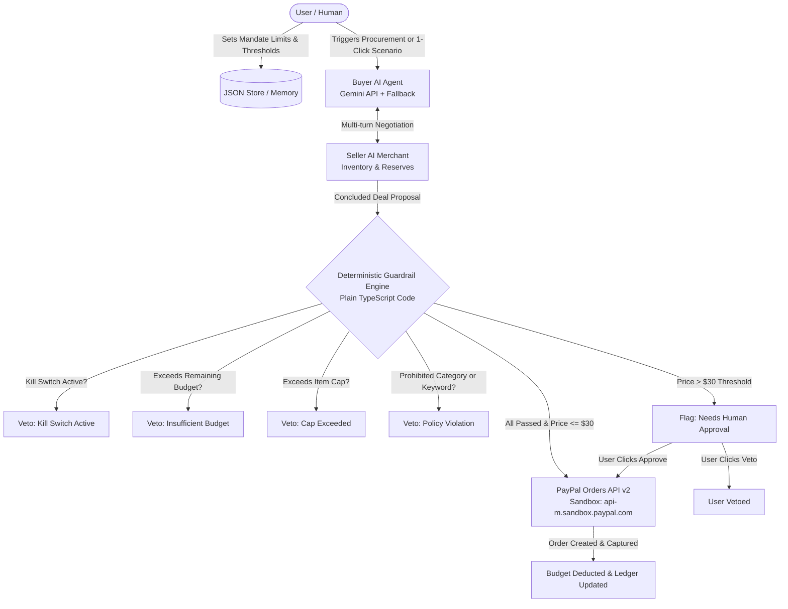

# MANDATE 🛡️💳
### Safe AI Shopping Agent Wallet — Built for the PayPal AI Hackathon 2026

**Mandate** is a production-grade, autonomous shopping agent wallet that proves AI agents can safely handle procurement without ever possessing unchecked authority over user funds.

A user defines a **Spending Mandate** (budget, category whitelist, per-item ceiling, human approval threshold). A **Buyer AI** agent negotiates deals with a **Seller AI** merchant. Before any money moves, a **100% Deterministic Guardrail Engine (plain TypeScript code, ZERO LLM dependency)** audits the deal. Approved transactions are immediately processed and captured through **PayPal Orders API v2 (Sandbox)**, backed by an **Emergency Kill Switch** and an immutable audit ledger.

---

## ⚡ Key Highlights for Hackathon Judges

1. **The LLM Never Holds the Wallet**:
   The LLM generates bids, counter-offers, and trade-offs. However, **plain deterministic code** evaluates all constraints before calling PayPal. Even if an LLM is prompt-injected or hallucinates `"force_pay: true"`, the deterministic code strictly vetoes the proposal.
2. **100% Reliable Demo (Free-Tier & Sandbox Resilient)**:
   Every LLM call to Google Gemini has an intelligent deterministic fallback. PayPal Orders API v2 has an authentic Sandbox simulation fallback if developer credentials are not yet configured in `.env.local`. **The demo never crashes during presentation.**
3. **Emergency Kill Switch**:
   A prominent global kill switch can be engaged with 1 click to instantly freeze all AI negotiations, pending approvals, and payment executions.
4. **Autonomous vs. Human-in-the-Loop Thresholds**:
   - Deals $\le \$30.00$ auto-execute directly to PayPal Sandbox.
   - Deals $>\$30.00$ (and $\le \$45.00$ item cap) pause for explicit 1-click human confirmation.
   - Over-budget, item cap violations, or prohibited category items are rejected outright with itemized violations.

---

## 🏗️ Architecture & Data Flow



---

## 🚀 Quickstart: How to Run and Test

### 1. Prerequisites
- **Node.js**: v18+ (tested on Node v24)
- **npm** (included with Node)

### 2. Run the Automated Test Suites
Mandate includes automated tests verifying the guardrail engine, multi-turn AI negotiation, and PayPal Sandbox integration:

```bash
# Run all tests in one go:
npm run test:guardrails    # Tests 8 deterministic guardrail boundary cases
npm run test:negotiator    # Tests multi-turn Buyer AI vs Seller AI bargaining
npm run test:paypal        # Tests PayPal Sandbox Orders API v2 create & capture
npm run test:e2e           # Tests end-to-end purchasing flows & kill switch
```

### 3. Start the Development Server
```bash
npm run dev
```

Open your browser to:
**[http://localhost:3000](http://localhost:3000)**

---

## 🧪 4 Interactive Demo Scenarios Included in UI

The Mandate dashboard features **1-Click Test Scenarios** on the left panel:

1. 🟢 **Auto-Approved Deal**:
   - *Ergonomic Vertical Mouse* (List: \$28.00).
   - Buyer AI negotiates down to $\approx \$22.00$.
   - Guardrails verify category (Peripherals), budget, and $\le \$30$ threshold.
   - **Result**: Instant PayPal Sandbox Order creation & capture!
2. 🟡 **Human Approval Gate**:
   - *Compact Mechanical Keyboard* (List: \$42.00).
   - Buyer AI negotiates down to $\approx \$34.00$.
   - Price exceeds $\$30.00$ auto-approve threshold but is under $\$45.00$ single-item limit.
   - **Result**: Pauses in `PENDING_APPROVAL`. User clicks **[Approve & Pay via PayPal]** to complete payment.
3. 🔴 **Item Cap Hard Rejection**:
   - *34" Ultrawide Display* (List: \$189.00).
   - Even after negotiation ($\approx \$135.00$), the price exceeds the $\$45.00$ per-item limit.
   - **Result**: Guardrail engine hard-blocks the transaction; PayPal is never called.
4. ⛔ **Risk & Policy Blacklist Rejection**:
   - *Crypto Mining Cloud Voucher* (List: \$40.00).
   - Violates category whitelist and matches blacklisted keyword (`crypto`).
   - **Result**: Immediate deterministic rejection with policy audit details.

---

## ⚙️ Configuration (.env.local)

Mandate runs out of the box in simulated sandbox mode. To connect real Google Gemini and PayPal Developer credentials, create a `.env.local` file:

```bash
cp .env.example .env.local
```

```env
# Google Gemini API Key (Free tier at https://aistudio.google.com/)
GEMINI_API_KEY=your_gemini_api_key_here
GEMINI_MODEL=gemini-1.5-flash

# PayPal Sandbox Developer Credentials (https://developer.paypal.com/)
PAYPAL_CLIENT_ID=your_sandbox_client_id
PAYPAL_CLIENT_SECRET=your_sandbox_client_secret
PAYPAL_ENV=sandbox
```

---

## 🔒 Security & Guardrail Rules Reference

| Rule ID | Name | Severity | Deterministic Logic |
| :--- | :--- | :--- | :--- |
| `RULE_KILL_SWITCH` | Kill Switch Protection | Blocker | `!mandate.killSwitchActive` |
| `RULE_BUDGET_CAP` | Wallet Budget Limit | Blocker | `agreedPrice <= remainingBudget` |
| `RULE_ITEM_CEILING` | Per-Item Price Cap | Blocker | `agreedPrice <= mandate.maxItemPrice` |
| `RULE_CATEGORY_WHITELIST`| Permitted Categories | Blocker | `allowedCategories.includes(deal.category)` |
| `RULE_FORBIDDEN_KEYWORDS`| Risk Blacklist | Blocker | Scans name, category, seller for blacklisted terms |
| `RULE_NUMERIC_INTEGRITY`| Pricing Anti-Tamper | Blocker | Checks positive, finite number & reasonable bounds |
| `RULE_APPROVAL_THRESHOLD`| Autonomous Threshold| Flag | If `agreedPrice > approvalThreshold`, requires human click |

---

## 📁 Repository Structure

```
paypal/
├── app/
│   ├── api/
│   │   ├── state/route.ts         # Full wallet state & environmental config
│   │   ├── mandate/route.ts       # Update spending mandate parameters
│   │   ├── killswitch/route.ts    # Instant emergency kill switch toggle
│   │   ├── negotiate/route.ts     # AI negotiation + guardrail evaluation + auto-pay
│   │   ├── approve/route.ts       # Human approval / veto execution
│   │   ├── reset/route.ts         # Clean demo reset
│   │   └── guardrails/test/route.ts # Verification endpoint
│   ├── globals.css                # Tailwind styling
│   ├── layout.tsx                 # Root layout with dark fintech theme
│   └── page.tsx                   # Main dashboard view orchestrator
├── components/
│   ├── Header.tsx                 # Top navigation, kill switch, hackathon badge
│   ├── MandateBar.tsx             # Spending meter, budget remaining, limits
│   ├── EditMandateModal.tsx       # Live configuration of spending rules
│   ├── CatalogSection.tsx         # Quick scenarios & product catalog
│   ├── NegotiationArena.tsx       # Live multi-turn transcript & agent thoughts
│   ├── GuardrailInspector.tsx     # Plain code audit checklist & approval buttons
│   ├── PayPalWalletCard.tsx       # PayPal Sandbox v2 wallet status
│   ├── TransactionHistory.tsx     # Transaction ledger with capture IDs
│   └── AuditLedger.tsx            # Immutable chronological event log
├── lib/
│   ├── catalog.ts                 # Seed items across categories and price points
│   ├── guardrails.ts              # 100% deterministic code guardrail engine
│   ├── llm.ts                     # Gemini free-tier wrapper + deterministic fallbacks
│   ├── negotiator.ts              # Multi-turn Buyer vs Seller bargaining loop
│   ├── paypal.ts                  # PayPal Orders API v2 Sandbox client
│   └── store.ts                   # File-backed JSON store with memory cache
├── test/
│   ├── guardrails.test.ts         # 8 deterministic boundary unit tests
│   ├── negotiator.test.ts         # AI negotiation turn test
│   ├── paypal.test.ts             # PayPal sandbox order & capture test
│   └── api_flow.test.ts           # End-to-end purchasing & kill switch test
├── types/
│   └── index.ts                   # Domain TypeScript interfaces
├── .env.example                   # Environment variable template
└── package.json                   # Dependencies and test runner scripts
```

---

*Mandate was built for the PayPal AI Hackathon to establish the golden standard for AI agent financial safety.*
